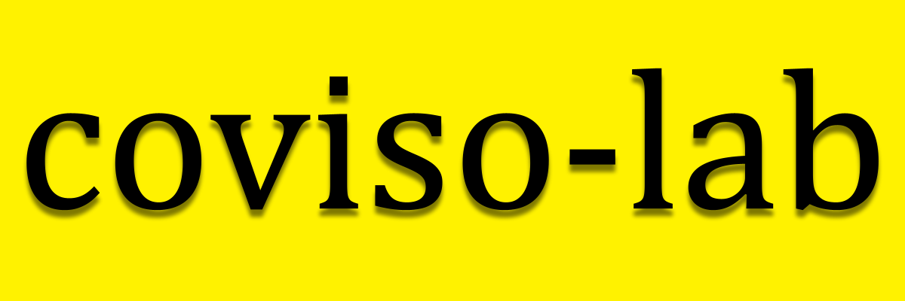

  

# COVISO LAB

This repository contains core implementations, infrastructure components, and reusable modules developed for computer vision projects.

#### Recent Implementations:

| # | Name | Level | Language |
| :---: | :--- | :---: | :---: |
| 1 | [Multi-Source GStreamer](https://github.com/hbaltunay/coviso-lab/tree/main/levels/1/multi-source-gstreamer) | 1 | C++ |
| 2 | [Any Batch Queue](https://github.com/hbaltunay/coviso-lab/tree/main/levels/1/any-batch-queue) | 1 | C++ |
| 3 | [Buffer Allocator](https://github.com/hbaltunay/coviso-lab/tree/main/levels/1/buffer-allocator) | 1 | C++ |
| 4 | [Circuit Breaker](https://github.com/hbaltunay/coviso-lab/tree/main/levels/1/circuit-breaker) | 1 | C++ |
| 5 | | | |
| 6 | | | |
| 7 | | | |
| 8 | | | |
| 9 | | | |
| 10 | | | |

## 📜 License

This project is licensed under the MIT License - see the [LICENSE](LICENSE) file for details.
